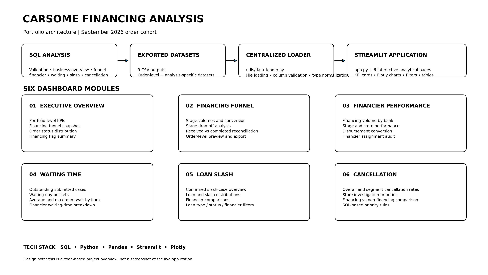

# CARSOME Financing Analysis Portfolio

An end-to-end data analytics portfolio project exploring financing performance, process conversion, financier-level outcomes, disbursement waiting time, loan amount reductions, and cancellation patterns.

The project combines SQL-based analysis, Python data preparation, and an interactive Streamlit application to turn order-level data and analytical extracts into business-oriented views.

> **Project scope:** September 2026 order cohort. The cohort is defined by order creation date; later financing, disbursement, and completion events may occur after the cohort month. Waiting-time analysis is a separate snapshot-based view, using the snapshot date defined in its analysis script.
>
> **Portfolio / privacy note:** This repository should contain only approved, anonymised or synthetic data. Do not publish customer-identifiable records, internal credentials, private database connection details, or confidential company information. Replace or remove any data that is not authorised for public release.

---

## Project Architecture Overview

The diagram below summarises the end-to-end workflow and the six analytical dashboard modules.



## 1. Project Objectives

The project is designed to answer six practical business questions:

1. What does the overall financing performance look like across the selected order cohort?
2. At which stages do financing cases progress or drop off?
3. How do financing volumes and downstream outcomes vary across financiers and CARSOME stores?
4. Which submitted-but-not-received disbursement cases have been waiting longer, and how does waiting time vary by financier?
5. What are the patterns in confirmed loan slash cases, loan amounts, and slash ratios?
6. Which stores should be prioritised for cancellation investigation based on overall and segment-level cancellation patterns?

The objective is descriptive business analysis and operational decision support. The results should not be interpreted as causal evidence of financier or store performance.

## 2. Analytical Workflow

```text
Source data
    |
    v
SQL data validation and business analysis
    |
    v
SQL result sets / dashboard datasets
    |
    v
CSV analytical extracts
    |
    v
Centralised Python data loader
    |
    v
Six-page Streamlit application
    |
    v
Business interpretation and recommendations
```

### Technology Stack

- **SQL** — data validation, aggregation, business rules, analytical datasets and dashboard views
- **Python** — data loading, validation, type conversion and dashboard calculations
- **Pandas** — data manipulation and analysis
- **Streamlit** — interactive multi-page dashboard
- **Plotly** — interactive charts and visual analysis
- **Jupyter Notebook** — exploratory data quality, feature and KPI work

## 3. Dashboard Modules

### 3.1 Executive Overview

Provides a high-level view of financing performance for the selected order cohort.

Main components:
- Total orders and financing cases
- Approved and accepted cases
- Disbursement submitted and received cases
- Completed orders
- Financing funnel snapshot
- Order status distribution
- Financing-stage flag summary
- Order-level data preview and CSV export

**Business use:** Gives stakeholders a concise overview of order volume and financing progression before drilling into individual process areas.

### 3.2 Financing Funnel Analysis

Examines progression through the financing process.

Main components:
- Total orders, financing cases and financing rate
- Approved, accepted, submitted and received case counts
- Stage-to-stage conversion rates
- Funnel visualisation
- Stage drop-off counts
- Financing process gap analysis
- Received-versus-completed reconciliation
- Order-level data summary

**Important interpretation:** Disbursement Received and Order Completed are different business events. They are analysed separately rather than treated as interchangeable statuses.

**Business use:** Helps identify where cases are lost or delayed between financing stages and where further operational investigation may be useful.

### 3.3 Financier Performance

Compares financing activity and downstream outcomes across financiers, with supporting store-level and assignment views.

Main components:
- Overall financing volume and stage counts by financier
- Financing-stage conversion summary
- Financier-by-store performance
- Disbursement received conversion
- Submitted-but-not-received cases
- Financier assignment audit and missing-financier review

**Important interpretation:** Financier assignment can be stage-dependent. Early-stage conversion rates grouped by the final recorded financier should not automatically be interpreted as independent bank approval performance. Missing or blank financier records are retained for audit purposes and excluded from relevant bank-to-bank comparisons.

**Business use:** Supports descriptive comparison of financing volumes, process outcomes and data completeness across financiers and stores.

### 3.4 Waiting Time Analysis

Focuses on submitted disbursement cases for which funds had not yet been recorded as received at the analysis snapshot.

Main components:
- Submitted-but-not-received case count
- Cases with and without a submission date
- Waiting-time buckets: 0–7, 8–14, 15–30 and over 30 days
- Average and maximum waiting days by financier
- Waiting-time distribution by financier

**Important interpretation:** Waiting days are calculated for eligible outstanding cases with a usable submission date. Cases missing a submission date are reported separately and excluded from waiting-day calculations. This is a snapshot-based analysis, not a live status feed.

**Business use:** Helps identify outstanding disbursement cases that may require follow-up and compare waiting-time patterns across financiers.

### 3.5 Loan Slash Analysis

Analyses records classified as confirmed loan slash cases.

Main components:
- Confirmed slash case count
- Total loan amount and total slash amount
- Average loan amount and average slash amount
- Average individual slash ratio
- Weighted slash-to-loan ratio
- Slash amount and loan amount distributions
- Comparisons by financier
- Filters for financier, order status and loan type

**Metric distinction:**
- Average slash ratio is the average of individual order-level ratios.
- Weighted slash-to-loan ratio is total slash amount divided by total loan amount.

These measures answer different questions and should not be treated as equivalent.

**Business use:** Helps describe the scale and distribution of confirmed loan reductions and compare patterns across available business dimensions.

### 3.6 Cancellation Analysis & Recommendations

Compares cancellation patterns across stores and between financing and non-financing orders.

Main components:
- Total orders and cancelled orders
- Overall cancellation rate
- Financing and non-financing cancellation rates
- Cancellation-rate gap in percentage points
- Store-level cancellation performance
- Store investigation priority groups
- SQL-defined priority classification rules
- Filters by store and investigation priority

The priority framework in the analysis distinguishes:
- **P1 — High Business Impact**
- **P2 — Large Cancellation Gap**
- **P3 — Regular Monitoring**
- **Low Group Volume — Monitor**

The dashboard displays the rule-based classifications produced by the analysis. These are investigation priorities, not proof of the underlying causes of cancellation.

**Business use:** Helps direct attention to stores with high cancellation impact or notable differences between financing and non-financing cancellation patterns.

---

## 4. SQL and Data Preparation

The `database/` directory contains SQL scripts organised around the analytical workflow:

| SQL script | Purpose |
|---|---|
| `01_data_validation.sql` | Validate source data and key fields |
| `02_business_overview.sql` | Establish the overall business view |
| `03_cancellation_analysis.sql` | Analyse cancellation patterns and investigation priorities |
| `04_financing_funnel.sql` | Build financing-stage and conversion analysis |
| `04_financing_performance.sql` | Analyse financing performance |
| `05_bank_branch_performance.sql` | Analyse financier and store-level performance |
| `06_loan_amount_analysis.sql` | Analyse loan amounts and loan slash |
| `07_Business_Insights & Recommendations.sql` | Consolidate business insights and recommendations |
| `08_Dashboard_Dataset_Preparation.sql` | Prepare datasets for dashboard consumption |
| `dashboard_views.sql` | Define dashboard-oriented SQL views |

The SQL scripts are the source of the business aggregations and analytical extracts. The Python loader is responsible for reading exported datasets, checking required columns, converting data types and normalising selected text fields.

## 5. Data Files

The project uses nine CSV extracts under `data/processed/`:

- `CARSOME_Financing_Dashboard.csv`
- `financier_overall_performance.csv`
- `financier_store_performance.csv`
- `financier_stage_conversion.csv`
- `financier_assignment_audit.csv`
- `financier_disbursement_conversion.csv`
- `CARSOME_Waiting_Time_Analysis.csv`
- `CARSOME_Loan_Slash_Analysis.csv`
- `CARSOME_Cancellation_Recommendations.csv`

The dashboard pages access these datasets through `utils/data_loader.py`, rather than defining separate file-loading logic in every page.

**Before publishing:** inspect every CSV for personal data, customer or order identifiers, internal-only fields, commercially sensitive values and any other information that is not approved for public release. If public sharing is not authorised, replace the files with synthetic/sample data that preserves the required column structure, or omit the data files and document how users can provide their own authorised extracts.

## 6. Jupyter Notebooks

The `notebooks/` directory contains the project’s analytical preparation work:

- `Data quality layer.ipynb`
- `Feature layer.ipynb`
- `Feature or KPI Layer.ipynb`

These notebooks preserve the exploratory and preparation stages that support the SQL and dashboard workflow.

## 7. Project Structure

```text
Carsome-financing-analysis-portfolio/
├── app.py
├── README.md
├── requirements.txt
├── data/
│   └── processed/
│       ├── CARSOME_Financing_Dashboard.csv
│       ├── CARSOME_Waiting_Time_Analysis.csv
│       ├── CARSOME_Loan_Slash_Analysis.csv
│       ├── CARSOME_Cancellation_Recommendations.csv
│       └── financier_*.csv
├── database/
│   ├── 01_data_validation.sql
│   ├── 02_business_overview.sql
│   ├── 03_cancellation_analysis.sql
│   ├── 04_financing_funnel.sql
│   ├── 04_financing_performance.sql
│   ├── 05_bank_branch_performance.sql
│   ├── 06_loan_amount_analysis.sql
│   ├── 07_Business_Insights & Recommendations.sql
│   ├── 08_Dashboard_Dataset_Preparation.sql
│   └── dashboard_views.sql
├── notebooks/
│   ├── Data quality layer.ipynb
│   ├── Feature layer.ipynb
│   └── Feature or KPI Layer.ipynb
├── pages/
│   ├── 1_Executive_Overview.py
│   ├── 2_Financing_Funnel.py
│   ├── 3_Financier_Performance.py
│   ├── 4_Waiting_Time_Analysis.py
│   ├── 5_Loan_Slash_Analysis.py
│   └── 6_Cancellation_Recommendations.py
└── utils/
    ├── __init__.py
    └── data_loader.py
```

## 8. Installation and Usage

### Requirements

The application uses the Python packages listed in `requirements.txt`, including Streamlit, Pandas, NumPy and Plotly.

### Setup

1. Clone or download this repository.
2. Open a terminal in the project root directory.
3. Create and activate a virtual environment (recommended).
4. Install the dependencies:

```bash
pip install -r requirements.txt
```

5. Confirm that the nine CSV datasets are available in `data/processed/` and that their column names match the requirements in `utils/data_loader.py`.
6. Start the Streamlit application:

```bash
streamlit run app.py
```

7. Use the Streamlit sidebar to navigate between the six dashboard pages.

If the application reports a missing dataset or required column, check the dataset path, file name and schema before running it again.

## 9. Analytical Considerations and Limitations

- **Cohort definition:** The primary financing cohort is based on order creation date in September 2026. Later process events can occur outside September.
- **Snapshot analysis:** Waiting-time results depend on the snapshot date embedded in the corresponding analysis. They should not be read as current live operational status.
- **Different business events:** Disbursement receipt and order completion are separate statuses.
- **Financier attribution:** Final financier assignment may be recorded at a later process stage. Comparisons should account for this assignment logic.
- **Missing data:** Missing dates and financier values are surfaced or handled explicitly where relevant; they should not silently be interpreted as zero activity.
- **Descriptive analysis:** The dashboards describe observed patterns and support investigation. They do not establish causality.

## 10. Data Privacy and Disclaimer

This is an independent portfolio presentation of data analytics methods and dashboard development. It is not an official CARSOME product or an endorsement by CARSOME.

All data shared publicly must be authorised for disclosure and appropriately anonymised or synthetic. No customer-identifiable information, credentials, private database details or confidential company information should be committed to the repository.

---

**Built with SQL, Python, Pandas, Streamlit and Plotly.**
